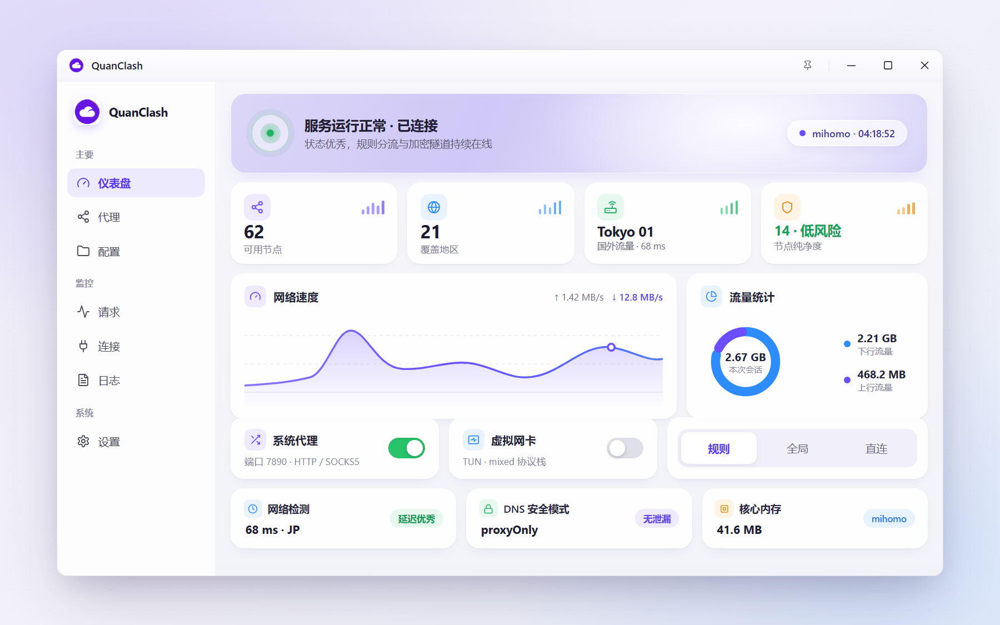
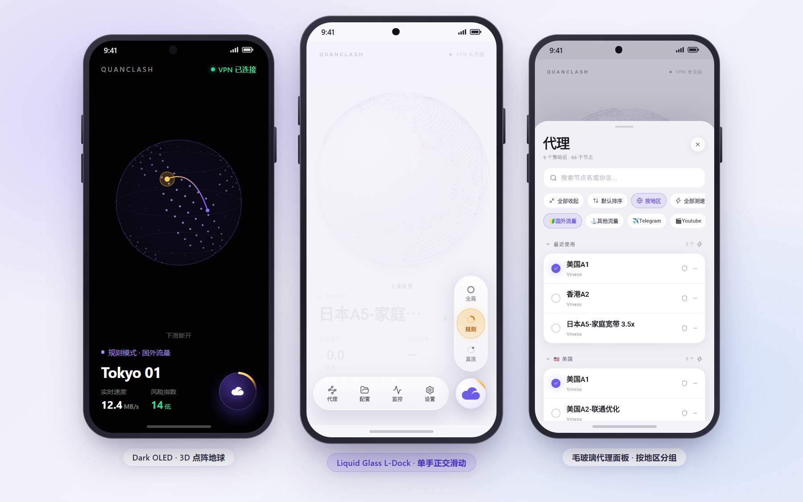

<div align="center">

# QuanClash

A Windows & Android proxy client built on mihomo.

[](LICENSE)
[](https://github.com/JavayVeneno/QuanClash/releases)
[](https://github.com/JavayVeneno/QuanClash/stargazers)

[简体中文](README_zh_CN.md)

</div>

<p align="center">
  
</p>

## What is QuanClash?

QuanClash is a cross-platform proxy client for **Windows** and **Android** built on
[mihomo](https://github.com/MetaCubeX/mihomo) (Clash.Meta).

- **On Windows**, it is a desktop-first client with a Windows 11 Fluent title bar,
  frosted-glass visual system, adaptive top/side navigation, fixed dashboard layout
  and a tray panel that starts, stops and switches nodes without opening the main window.
- **On Android**, **Mobile v4** reimagines the mobile client around a single-surface
  3D dot-matrix globe canvas, an Obsidian-Amethyst QuanClash floating hub with an
  orthogonal **Liquid Glass L-Dock**, and desktop-parity frosted modal sheets.

The project is a modified version of [FlClash](https://github.com/chen08209/FlClash).
It keeps the GPL-3.0 license and documents the upstream attribution in
[NOTICE](NOTICE).

## Android Mobile v4

<p align="center">
  
</p>

- **3D Dot-Matrix Globe.** Natural Earth 110m dot-matrix sphere that smoothly tracks
  the active proxy node's geography, with swipe-up to connect and swipe-down to disconnect.
- **Obsidian-Amethyst Hub & Liquid Glass L-Dock.** Tap the floating QuanClash orb to
  switch outbound modes (each mode reflects a distinct gold rim: crescent for Rule,
  360° halo for Global, minimal spark for Direct). Long-press to expand a Liquid Glass
  capsule rail horizontally (`Proxy / Config / Monitor / Settings`) and a mode rail
  vertically (`Global / Rule / Direct`) for one-handed thumb sliding.
- **Dark OLED & Light Porcelain Themes.** Pure `#000000` OLED dark mode, Light
  Porcelain mode, and Follow System switching, paired with Android-wide Liquid Glass
  transparent-lens switches.
- **Desktop Feature Parity.** Frosted modal sheets cover Proxy search, sorting, region
  grouping, expand/collapse all, batch latency tests and node risk checks; Config
  import, editor and auto-update scheduling; Monitor telemetry, DNS path diagnostics,
  On-Demand rules, Backup & Restore, and Geo resources.

## Why QuanClash?

- **Desktop-first on Windows.** Windows 11 Fluent title bar, top navigation in normal
  windows, side rail when maximized, and a tray-first workflow.
- **One-handed Mobile v4 on Android.** Single-surface globe canvas plus Liquid Glass
  L-Dock navigation instead of nested tab clutter.
- **DNS safety by design.** Explicit `compatible`, `proxyOnly` and `custom` modes
  plus a read-only DNS path diagnostic on both Windows and Android.
- **Real engineering.** Go mihomo core, Rust Windows helper, framed IPC over named
  pipes, 600+ Flutter tests and automated Windows + Android GitHub Actions CI.

## Platform support

| Platform | Status |
|---|---|
| Windows | Primary desktop target; built and tested in CI for every release (installer + portable zip) |
| Android | Primary mobile target (Mobile v4); built in CI for every release (split-per-ABI APKs) |
| macOS, Linux | Buildable from the same codebase (inherited from FlClash), not currently tested or published |

## Features

- **Windows Desktop:** Frosted-glass UI, Windows 11 Fluent title bar, light/dark/pure-black
  themes, adaptive navigation, fixed dashboard and magpie-style tray panel.
- **Android Mobile v4:** 3D dot-matrix globe, Liquid Glass L-Dock, Liquid Glass switches,
  monochrome QuanClash VPN status-bar & Quick Settings tile icons, and full-parity
  frosted sheets.
- **Core & Routing:** Subscription profiles, rule/script overrides, WebDAV sync,
  system proxy, TUN mode, per-app proxy (Android), and On-Demand Wi-Fi rules.
- **DNS & Quality:** TCP/UDP DNS with explicit DNS safety modes
  (`compatible`, `proxyOnly`, `custom`), read-only DNS path diagnostic, and manual
  node-quality checks (Cloudflare and opt-in IPPure) separate from latency ranking.
- **Telemetry:** Real-time connections, request logs, runtime logs, traffic breakdown,
  and incremental TrafficClass inspection.

## Download

[](https://github.com/JavayVeneno/QuanClash/releases/latest)
[](https://github.com/JavayVeneno/QuanClash/releases/latest)

Builds are published on the
[Releases](https://github.com/JavayVeneno/QuanClash/releases) page. Each release ships
Windows (installer + portable zip) and Android (`arm64-v8a`, `armeabi-v7a`, `x86_64` APKs).

## Build

1. Update submodules:

   ```bash
   git submodule update --init --recursive
   ```

2. Install Flutter and Go. CI uses Flutter stable (3.44.4) and the Go version declared
   in `core/go.mod`.

3. Build the app for your target platform:

   ```bash
   dart setup.dart android
   dart setup.dart windows
   dart setup.dart linux
   dart setup.dart macos
   ```

   - **Windows:** install GCC and Inno Setup.
   - **Android:** install JDK 17, Android SDK and NDK, and set `ANDROID_NDK`.
   - **Linux:** install GTK and keybinder dependencies:
     `sudo apt-get install libayatana-appindicator3-dev libkeybinder-3.0-dev`
   - **macOS:** install `appdmg` (`npm install -g appdmg`).

## Project layout

- `lib/` — Flutter application (Windows desktop UI, Android Mobile v4, managers, providers, core transport).
- `core/` — Go wrapper around the mihomo core plus QuanClash-specific actions.
- `core/Clash.Meta/` — mihomo submodule (GPL-3.0).
- `plugins/` — local Flutter plugins (Rust API, setup/build tooling, platform helpers).

## Contributing

Issues and pull requests are welcome. See [CONTRIBUTING.md](CONTRIBUTING.md)
for the build, test and code-generation workflow, [CODE_OF_CONDUCT.md](CODE_OF_CONDUCT.md)
for community expectations, and [SECURITY.md](SECURITY.md) for reporting
vulnerabilities privately.

## License and attribution

QuanClash is free software under the **GNU General Public License v3.0**. See
[LICENSE](LICENSE) and [NOTICE](NOTICE).

- Upstream project: [FlClash](https://github.com/chen08209/FlClash),
  Copyright (C) chen08209 and contributors, GPL-3.0.
- Data plane: [mihomo / Clash.Meta](https://github.com/MetaCubeX/mihomo),
  GPL-3.0.

Changes made in this fork include rebranding, the Windows desktop UI redesign,
Android Mobile v4 single-surface redesign, DNS safety configuration and diagnostics,
node-quality checks, incremental connection inspection and TrafficClass groundwork.
The git history records the details.
