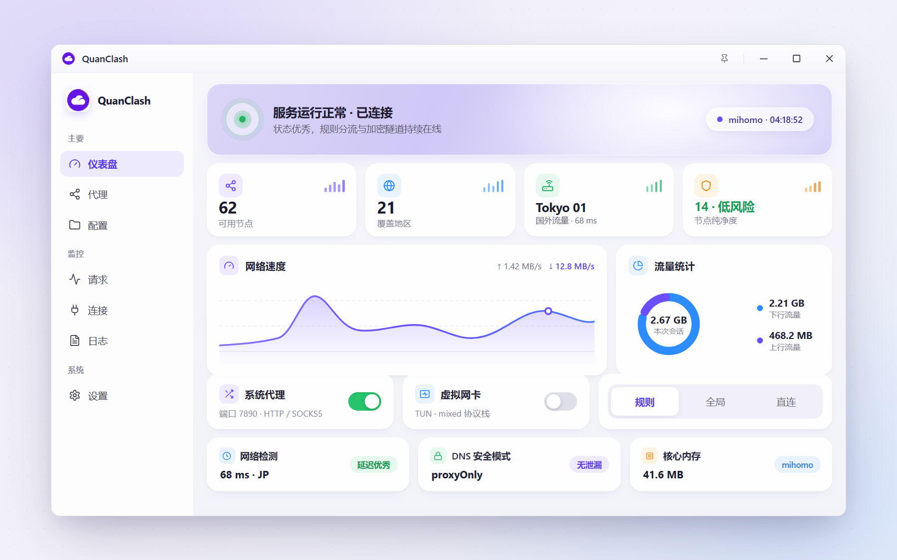
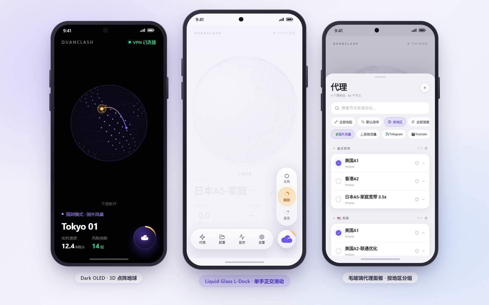

<div align="center">

# QuanClash

基于 mihomo 的 Windows 与 Android 跨端代理客户端。

[](LICENSE)
[](https://github.com/JavayVeneno/QuanClash/releases)
[](https://github.com/JavayVeneno/QuanClash/stargazers)

[English](README.md)

</div>

<p align="center">
  
</p>

## 项目简介

QuanClash 是一个面向 **Windows** 与 **Android** 的代理客户端，数据面使用
[mihomo](https://github.com/MetaCubeX/mihomo)（Clash.Meta）：

- **Windows 桌面端**：围绕窗口、托盘和桌面工作流打造，提供 Windows 11 Fluent
  质感标题栏、应用内毛玻璃视觉体系、自适应顶部/侧边导航、固定仪表盘布局，以及无需打开主窗口即可启停与切节点的托盘面板。
- **Android 移动端（Mobile v4）**：以单画布 3D 点阵地球、黑曜暗紫琉璃主控球与
  **液态玻璃 L-Dock 正交滑动坞**为核心，在保留极简单手操控的同时提供与桌面端完整对齐的毛玻璃功能面板。

本项目是 [FlClash](https://github.com/chen08209/FlClash) 的修改版本，继续采用
GPL-3.0 许可证，上游署名与修改说明见 [NOTICE](NOTICE)。

## Android 移动端（Mobile v4）

<p align="center">
  
</p>

- **3D 点阵地球画布**：基于 Natural Earth 110m 的 3D 点阵地球，随当前活跃代理节点地理位置实时聚焦旋转，支持上滑连接、下滑断开。
- **黑曜暗紫主控球 & 液态玻璃 L-Dock**：轻按右下角 QuanClash 琉璃云球直接切换出站模式，并呈现三种专属鎏金光效（规则新月弧、全局 360° 鎏金光环、直连极简星芒）；长按后自动向左展开液态玻璃胶囊导航（代理 / 配置 / 监控 / 设置）、向上展开三模式滑轨（全局 / 规则 / 直连），单手拇指滑动直达。
- **深色 OLED / 浅色瓷白主题 & 液态玻璃开关**：支持纯黑 `#000000` OLED、浅色瓷白与跟随系统切换；Android 全系统开关升级为液态玻璃透明透镜滑块。
- **桌面级完整功能对齐**：毛玻璃底部面板完整覆盖代理搜索/排序/按地区分组/一键收起展开/全部测速/节点风险检测、配置导入/编辑/定时更新、实时监控与流量卡片、DNS 诊断、按需连接、备份恢复与 Geo 资源管理。

## 为什么选择 QuanClash？

- **Windows 桌面优先体验**：Windows 11 Fluent 标题栏、随窗口尺寸自适应的导航布局，以及开箱即用的托盘快捷工作流。
- **Android Mobile v4 单手交互**：告别层层嵌套的传统 Tab，单画布 3D 地球 + 液态玻璃 L-Dock 让高频操作一滑即达。
- **DNS 安全是设计的一部分**：双端均提供显式的 `compatible`、`proxyOnly`、`custom` 安全模式及只读 DNS 路径诊断。
- **真实工程实践**：Go mihomo 内核、Rust Windows 辅助服务、命名管道 IPC、600+ Flutter 自动化测试以及 Windows + Android GitHub Actions CI。

## 平台支持

| 平台 | 状态 |
|---|---|
| Windows | 主要桌面目标平台，每次发布均由 CI 构建并测试（安装包 + 便携压缩包） |
| Android | 主要移动目标平台（Mobile v4），每次发布均由 CI 构建（分架构 APK） |
| macOS、Linux | 同一套代码可以构建（继承自 FlClash），目前未在 CI 测试与发布 |

## 核心功能

- **Windows 桌面端**：毛玻璃界面、Windows 11 Fluent 标题栏、浅色/深色/纯黑模式、自适应导航栏、固定仪表盘与 magpie 式托盘面板。
- **Android 移动端**：Mobile v4 3D 点阵地球、液态玻璃 L-Dock、透明透镜液态开关、原生单色 QuanClash 状态栏与快捷磁贴图标，以及全功能毛玻璃面板。
- **核心与分流**：订阅配置管理、规则/脚本覆写、WebDAV 同步、系统代理、TUN 虚拟网卡、Android 分应用代理与按需连接。
- **DNS 与节点质量**：TCP/UDP DNS 及显式 DNS 安全模式（`compatible`、`proxyOnly`、`custom`）、只读 DNS 路径诊断，以及独立于延迟排序的手动节点质量检测（Cloudflare 与可选 IPPure）。
- **监控与可观测性**：实时连接、请求记录、运行日志、会话流量统计，以及持续演进的 TrafficClass 流量分类管线。

## 下载

[](https://github.com/JavayVeneno/QuanClash/releases/latest)
[](https://github.com/JavayVeneno/QuanClash/releases/latest)

构建产物发布在 [Releases](https://github.com/JavayVeneno/QuanClash/releases)
页面，每个版本提供 Windows（安装包 / 便携 zip）与 Android（`arm64-v8a`、`armeabi-v7a`、`x86_64` APK）。

## 构建

1. 更新子模块：

   ```bash
   git submodule update --init --recursive
   ```

2. 安装 Flutter 与 Go。CI 使用 Flutter stable（3.44.4），Go 版本以 `core/go.mod` 为准。

3. 构建目标平台：

   ```bash
   dart setup.dart android
   dart setup.dart windows
   dart setup.dart linux
   dart setup.dart macos
   ```

   - **Windows**：安装 GCC 与 Inno Setup。
   - **Android**：安装 JDK 17、Android SDK/NDK，并设置 `ANDROID_NDK`。
   - **Linux**：先安装 GTK 与 keybinder 依赖：
     `sudo apt-get install libayatana-appindicator3-dev libkeybinder-3.0-dev`
   - **macOS**：安装 `appdmg`（`npm install -g appdmg`）。

## 目录结构

- `lib/`：Flutter 应用（Windows 桌面端、Android Mobile v4、管理器、Provider、核心通信）。
- `core/`：mihomo 内核的 Go 封装，以及 QuanClash 自有动作。
- `core/Clash.Meta/`：mihomo 子模块（GPL-3.0）。
- `plugins/`：本地 Flutter 插件（Rust API、构建工具、平台辅助）。

## 参与贡献

欢迎提交 issue 和 pull request。构建、测试与代码生成流程见
[CONTRIBUTING.md](CONTRIBUTING.md)，社区规范见
[CODE_OF_CONDUCT.md](CODE_OF_CONDUCT.md)，安全漏洞请按
[SECURITY.md](SECURITY.md) 私密报告。

## 许可证与署名

QuanClash 以 **GNU General Public License v3.0** 发布，详见
[LICENSE](LICENSE) 与 [NOTICE](NOTICE)。

- 上游项目：[FlClash](https://github.com/chen08209/FlClash)，
  Copyright (C) chen08209 及贡献者，GPL-3.0。
- 数据面：[mihomo / Clash.Meta](https://github.com/MetaCubeX/mihomo)，GPL-3.0。

本分支的修改包括品牌替换、Windows 桌面界面重做、Android Mobile v4 单画布重构、
DNS 安全配置与诊断、节点质量检测、增量连接检查以及 TrafficClass 基础工作；具体变更记录在 git 历史中。
